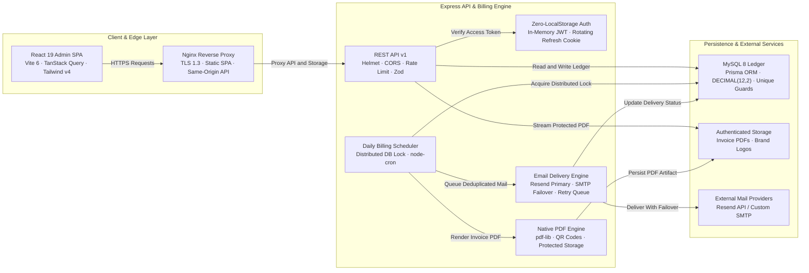
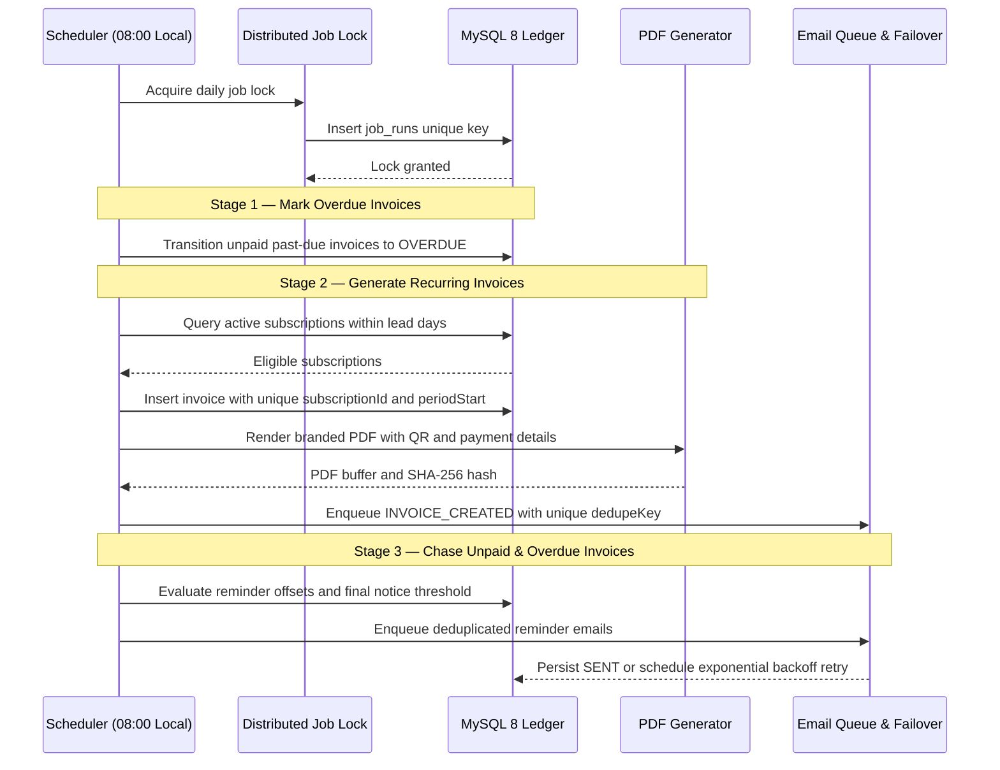
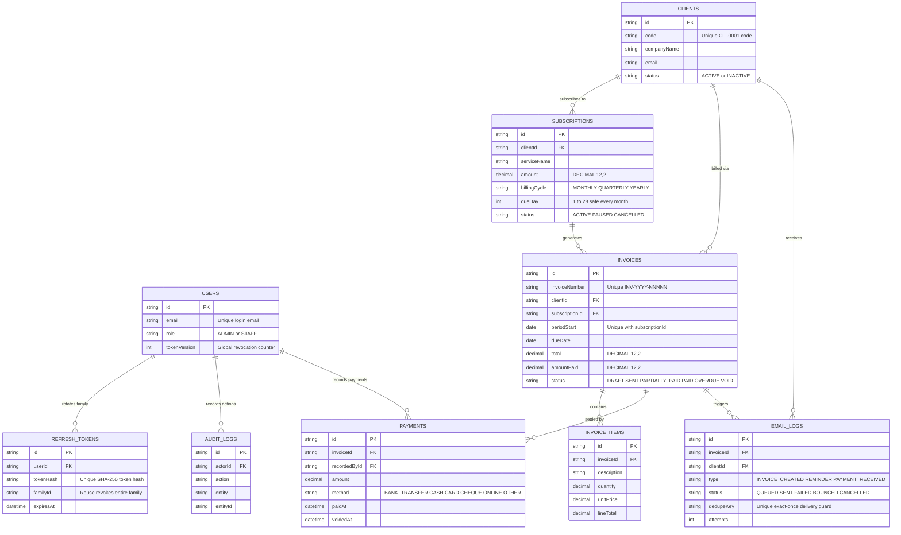

<div align="center">

# AutoBilling

**Idempotent, Self-Hosted Recurring Billing, PDF Invoicing & Payment Chasing Engine**  
*Add a client once. Automate invoice generation, branded PDF delivery, receivables tracking, and overdue escalation forever.*

[](https://www.typescriptlang.org/)
[](https://react.dev/)
[](https://nodejs.org/)
[](https://expressjs.com/)
[](https://www.prisma.io/)
[](https://www.mysql.com/)
[](https://tailwindcss.com/)
[](./LICENSE)

</div>

---

## Overview

**AutoBilling** is a production-hardened, full-stack recurring billing and accounts-receivable automation platform engineered for agencies, SaaS teams, and B2B service providers. Rather than relying on brittle application-level flags, every critical financial invariant—from invoice period uniqueness to email deduplication and distributed job locking—is enforced directly at the database layer.

It ships as a clean monorepo with a **TypeScript/Express + Prisma/MySQL 8** backend, a **React 19 + Vite 6 + Tailwind CSS v4** admin SPA, native **PDF + QR invoice generation**, dual-provider email failover (**Resend + SMTP**), and turnkey **AWS EC2** and **Oracle Cloud** deployment automation.

---

## System Architecture



---

## Daily Billing Pipeline (Strictly Ordered & Idempotent)

The billing pipeline enforces strict sequential execution inside a single orchestrated run so reminder emails never evaluate stale invoice states. Each stage acquires a database-backed distributed lock (`job_runs(jobName, runKey)`) with automatic stale-run takeover after 30 minutes.



---

## Core Data Model

All monetary values use `DECIMAL(12,2)` (never IEEE-754 floats). Financial documents (`invoices`, `payments`) are immutable ledgers—voided or reversed rather than deleted—with full `before`/`after` JSON audit trails.



---

## Key Engineering Highlights

| Domain | Architecture & Guarantees |
| :--- | :--- |
| **Database-Enforced Idempotency** | Unique constraints on `invoices(subscriptionId, periodStart)`, `email_logs(dedupeKey)`, and `job_runs(jobName, runKey)` make invoice generation, reminders, and cron retries 100% safe to execute repeatedly without duplicates. |
| **Financial Ledger Integrity** | Strict `DECIMAL(12,2)` arithmetic, transactional invoice numbering (`number_sequences`), void/reversal workflows instead of destructive deletes, and structured `AuditLog` snapshots (`before`/`after` JSON diffs). |
| **Zero-LocalStorage Security** | Short-lived JWT access tokens live strictly in memory (immune to `localStorage` XSS exfiltration). Refresh tokens use `httpOnly` same-origin cookies with token rotation families—reusing a revoked token invalidates the entire family. Frontend implements a single-flight refresh mutex so concurrent `401` responses trigger only one refresh call. |
| **Encrypted Secrets at Rest** | Runtime SMTP credentials stored in `settings` are encrypted using **AES-256-GCM** (`ENCRYPTION_KEY`) and never returned to the browser (`smtpPasswordSet: boolean`). |
| **Native Branded PDF Engine** | Generates crisp A4 invoices via `pdf-lib` with dynamic payment-instruction box sizing, company logo embedding, QR code support, and authenticated `/storage` file delivery behind `requireAuth`. |
| **Resilient Multi-Provider Email** | Resend API primary transport with automatic SMTP failover, console dry-run mode for safe pre-launch testing, Outlook/Gmail/Apple Mail table-layout templates, and exponential backoff retry scheduling every 15 minutes. |
| **Observability & Analytics** | Executive dashboard with MRR/ARR snapshots, cash-collected vs. billed trends, receivables ageing buckets (`current`, `1-30`, `31-60`, `61-90`, `90+`), top-client rankings, and structured Pino JSON logging with `X-Request-Id` tracing. |
| **Dual-Cloud IaC Automation** | Idempotent provisioning, zero-downtime migration-before-restart releases, fail2ban, TLS certbot setup, and keyless offsite backups for both **AWS EC2 + S3 IAM Role** and **Oracle Cloud Always Free + OCI Instance Principal**. |

---

## Repository Structure

```text
autobilling/
├── deploy/
│   ├── aws/                     # AWS EC2 bootstrap, deploy, nginx & S3 IAM backup scripts
│   └── oracle/                  # Oracle Cloud ARM bootstrap, deploy, nginx & OCI backup scripts
├── docs/
│   ├── API.md                   # Complete REST API v1 contract & payload reference
│   ├── DEPLOY-AWS.md            # AWS Free Tier EC2 + S3 production guide
│   ├── DEPLOY-ORACLE.md         # Oracle Cloud Always Free production guide
│   ├── FIRST-CLIENT.md          # Safe onboarding checklist for your first billing client
│   ├── GOING-LIVE.md            # End-to-end local -> DNS/email -> VPS launch guide
│   └── PRELAUNCH.md             # Dry-run verification & pre-flight checklist
├── server/
│   ├── prisma/
│   │   ├── migrations/          # Versioned MySQL 8 SQL migrations
│   │   ├── schema.prisma        # Relational ledger & idempotency schema
│   │   └── seed.ts              # Idempotent admin, staff, settings & optional demo seed
│   ├── src/
│   │   ├── config/              # Fail-fast Zod environment validation
│   │   ├── jobs/                # Distributed lock, daily pipeline, retries & CLI runner
│   │   ├── lib/                 # AES-256-GCM crypto, money math, dates, numbering & tests
│   │   ├── middleware/          # Auth, RBAC, Zod validation, audit trail, rate limiting
│   │   ├── modules/             # auth, clients, subscriptions, invoices, payments, dashboard, emaillogs, settings
│   │   ├── scripts/             # CLI client onboarding utility (addClient.ts)
│   │   ├── services/            # Native PDF invoice renderer & Resend/SMTP email engine
│   │   ├── app.ts               # Hardened Express application factory
│   │   └── server.ts            # Graceful HTTP & scheduler lifecycle bootstrap
│   ├── Dockerfile               # Production Node 22 container image
│   └── ecosystem.config.cjs     # PM2 production process definition
└── web/
    ├── public/                  # SVG assets
    └── src/
        ├── components/          # Reusable UI primitives, layout shell, DataTable, Modal
        ├── features/            # AuthProvider (in-memory token lifecycle) & client hooks
        ├── lib/                 # Single-flight API client, currency formatters, React Query keys
        ├── pages/               # Dashboard, Clients, Subscriptions, Invoices, Payments, Email Logs, Settings
        ├── styles/              # Light/dark design tokens (Tailwind CSS v4)
        └── types/               # End-to-end TypeScript API contracts
```

---

## Getting Started

### Prerequisites

- **Node.js** `>= 20.9.0` (Node 22 LTS recommended)
- **MySQL 8.0+**
- **npm** `>= 10`

### 1. Clone & Create the Database

```bash
git clone https://github.com/theekshana-sudeepa/autobilling.git
cd autobilling

mysql -u root -e "CREATE DATABASE autobilling CHARACTER SET utf8mb4 COLLATE utf8mb4_unicode_ci;"
```

### 2. Configure & Start the Backend (`server/`)

```bash
cd server
cp .env.example .env
```

Generate cryptographically secure secrets and paste them into `server/.env`:

```bash
node -e "for (const k of ['JWT_ACCESS_SECRET','JWT_REFRESH_SECRET','ENCRYPTION_KEY']) console.log(k+'='+require('crypto').randomBytes(32).toString('hex'))"
```

For local testing without sending real emails, set `EMAIL_PROVIDER=console` in `server/.env`. Then install, migrate, seed, and start:

```bash
npm install
npx prisma generate
npx prisma migrate dev
SEED_DEMO=true npm run seed
npm run dev
```

> **Default seeded credentials** (change immediately in any non-local environment):  
> Admin: `admin@example.com` / `ChangeMe123!` (or set `SEED_ADMIN_PASSWORD`)  
> Staff: `staff@example.com` / `ChangeMe123!`

### 3. Configure & Start the Frontend (`web/`)

Open a second terminal:

```bash
cd web
cp .env.example .env
npm install
npm run dev
```

Visit `http://localhost:5173` — the Vite dev proxy keeps `/api` and `/storage` first-party so `httpOnly` refresh cookies behave identically to production.

### 4. Verify Billing Jobs & Unit Tests

```bash
cd server

# Run unit tests (date arithmetic, due-day rollover, numbering)
npm test

# Trigger billing jobs manually via CLI
npm run jobs:run -- generate
npm run jobs:run -- pipeline
npm run jobs:run -- retry
```

---

## Documentation & Production Deployment

- **[API Reference](./docs/API.md)** — Full endpoint catalog, authentication flows, and payload schemas
- **[Going Live Guide](./docs/GOING-LIVE.md)** — Local testing → Resend DNS verification → single-VPS hosting
- **[AWS EC2 Deployment](./docs/DEPLOY-AWS.md)** — 1 GB Free Tier swap/MySQL tuning, Nginx TLS, and keyless S3 IAM backups
- **[Oracle Cloud Deployment](./docs/DEPLOY-ORACLE.md)** — Always Free ARM provisioning, iptables hardening, and OCI Object Storage backups
- **[Pre-Launch Checklist](./docs/PRELAUNCH.md)** — End-to-end dry run and production verification gates

---

## License

Distributed under the **MIT License**. See [`LICENSE`](./LICENSE) for details.

---

<div align="center">

**Engineered by [Theekshana Sudeepa](https://github.com/theekshana-sudeepa)**  
[LinkedIn](https://www.linkedin.com/in/theekshana-sudeepa/) · [GitHub](https://github.com/theekshana-sudeepa) · [LexoraTech](https://lexoratech.com)

</div>
